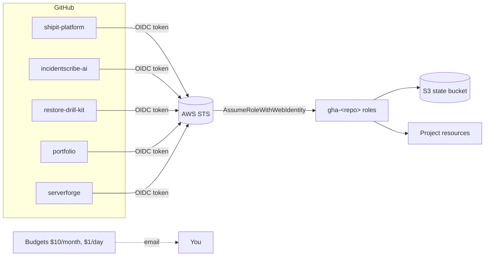

# aws-foundation

The shared base that every other project in this portfolio builds on. Run it **once** per AWS account.

| What it creates | Why | Cost |
|---|---|---|
| S3 bucket `tfstate-<account>-<region>` (versioned, encrypted, private) | Remote Terraform state for every project, with S3-native state locking (`use_lockfile`) | a few cents a year |
| GitHub Actions OIDC provider | Workflows log in to AWS with short-lived tokens. **No access keys stored anywhere.** | free |
| One deploy role per repo: `gha-<repo>` | Each repo can only assume its own role, and only from `main` or the `aws` environment | free |
| Permissions boundary `gha-workload-boundary` | Every role a project creates must carry it, so no project role can ever change IAM | free |
| Monthly budget ($10) + daily budget ($1) with email alerts | You hear about a forgotten stack within a day | free (alert-only budgets cost nothing) |
| Security baseline (`modules/security-baseline`): S3 Block Public Access, EBS encryption by default, no public snapshots, IMDSv2 by default, password policy, IAM Access Analyzer, ECR scan on push | The free guardrails the S8 security check asks every client for - this account passes its own check | free |
| CloudTrail: multi-region trail with log-file validation into a private, versioned bucket (365 days) | Who did what, for any investigation | cents a month |



## The fix pack (service S8)

The same baseline is what clients get after an **AWS Security Baseline Check**:
[`modules/security-baseline`](modules/security-baseline) (Terraform, one input per control) and
[`fix-pack/`](fix-pack) (what a module cannot fix: CLI and console steps, dry-run-first scripts).
GuardDuty (`enable_guardduty`) and AWS Config are off here to keep this account near $0; turn GuardDuty on
when you want this account to score 100 on its own check.

## Prerequisites

- AWS account, AWS CLI v2 logged in as an admin (`aws login`, `aws sso login` or `aws configure`).
  Accounts from the new AWS sign-up ("projects": one Region, no root user) work too: set
  `project_account = true` - they cannot create OIDC providers, so no GitHub deploy roles are made,
  and IAM Access Analyzer / GuardDuty are skipped.
- Terraform >= 1.10, `gh` logged in (for the connect step), `jq`.
- All of these are installed by `../_setup/install-tools-wsl.sh`.

## Run it

Step-by-step from a fresh laptop: **Project Hosting Guides / 02 - AWS Foundation** (a private guide kept outside this repository).

```bash
# 1. put your email in ../_setup/config.env  (ALERT_EMAIL=...)
bash scripts/up.sh                 # state bucket + Terraform (type "yes") + connect every GitHub repo
bash scripts/status.sh             # roles, budgets, which projects have resources in AWS
```

`up.sh` runs `bootstrap.sh` (state bucket + `terraform apply`) and then `connect-github.sh` (writes
`AWS_ROLE_ARN` / `AWS_REGION` into every published GitHub repo). Both are idempotent: run `up.sh` again any time.
`bootstrap.sh` detects an existing GitHub OIDC provider (for example from an older project like TraceLens) and reuses it instead of failing.

## Security design (interview talking points)

- **Trust policy is narrow:** `sub` must be `repo:<owner>/<repo>:ref:refs/heads/main` or `repo:<owner>/<repo>:environment:aws`. Pull requests from forks can never get credentials.
- **Blast radius per repo:** each repo has its own role. Projects that must create IAM roles (ECS task roles, Lambda roles, EKS roles) may only manage roles whose names start with their prefix (`shipit*`, `incidentscribe*`, ...).
- **Prefixes alone are not enough, so roles get a permissions boundary.** With prefix-scoped IAM only, a compromised workflow could create `shipit-x`, attach `AdministratorAccess`, trust itself and assume it. The deploy roles may only create (or give policies to) roles that carry `gha-workload-boundary`, a ceiling that allows everything except IAM, Organizations and account changes, and they can never remove a boundary or edit the boundary policy. Every project's Terraform sets `permissions_boundary` on its roles.
- **Trade-off I chose on purpose:** deploy roles use `PowerUserAccess` + prefix-scoped IAM. That keeps Terraform deploys reliable while I learn. The next step would be service-scoped policies generated from CloudTrail (IAM Access Analyzer policy generation).
- **Bill Doctor's role is read-only** (ReadOnlyAccess + SecurityAudit, for the monthly cost and security scans) and the hardening-kit demo role has **zero permissions**: it only proves OIDC works (`sts:GetCallerIdentity` needs no permission).

## Remove it

Do this last - every other project must be down first (their Control and Auto-stop workflows use the
deploy roles). `down.sh` refuses while another project still has resources in the state bucket and tells you which.

```bash
bash scripts/down.sh          # roles, budgets, guardrails, CloudTrail removed; keeps the state bucket
                              # and the CloudTrail log archive (cents a month) - `up.sh` re-adopts them later
bash scripts/down.sh --all    # also empties and deletes the log archive and the state bucket: nothing is left
```

`down.sh` also removes `AWS_ROLE_ARN` from the connected repositories, so their AWS workflows are skipped
instead of failing against a deleted role; `up.sh` connects them again. To take every project and then the
foundation down in the right order: `bash ../_setup/projects.sh down everything`.

## Upgrading an existing setup

The two guardrails that used to be defined inline now live in the module; `moved` blocks keep their state,
so `bootstrap.sh` simply adds the new controls and the trail.

If you ran `bootstrap.sh` before the permissions boundary existed, run it again (it's idempotent), then
redeploy any project that is up: its next `terraform apply` adds the boundary to its existing roles.
Also re-run `connect-github.sh` if you ran it before the `aws` environment was limited to `main`.
